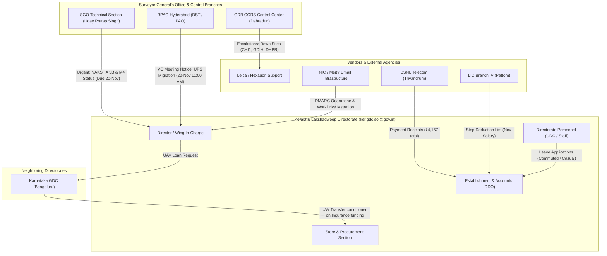

# Email Analysis & Operations Master Documentation

A unified, comprehensive analytical reference consolidating all email communications, operational intelligence, administrative workflows, travel records, and technical learnings across mailbox archives.

---

## Table of Contents

1. [Executive Overview & Repository Setup](#1-executive-overview--repository-setup)
2. [Data Security, Git Tracking & Compliance](#2-data-security-git-tracking--compliance)
3. [Email Archives & Processing Chronology](#3-email-archives--processing-chronology)
4. [Archive 1 Breakdown: Personal Travel & NIC Migration (`email458144603.zip`)](#4-archive-1-breakdown-personal-travel--nic-migration-email458144603zip)
   - [Air Travel: IndiGo Flight DL1262710CK30612](#air-travel-indigo-flight-dl1262710ck30612)
   - [Rail Travel: IRCTC Booking & Cancellation](#rail-travel-irctc-booking--cancellation)
   - [Travel Insurance: United India Insurance](#travel-insurance-united-india-insurance)
   - [Financial Reconciliation & Travel Ledger](#financial-reconciliation--travel-ledger)
   - [NIC Cloud Infrastructure: GovDrive to WorkDrive Migration](#nic-cloud-infrastructure-govdrive-to-workdrive-migration)
5. [Archive 2 Breakdown: Kerala & Lakshadweep Directorate Operations (`email-1653461983.zip`)](#5-archive-2-breakdown-kerala--lakshadweep-directorate-operations-email-1653461983zip)
   - [Action-Critical & Urgent Directives](#action-critical--urgent-directives)
   - [CORS Network Infrastructure & Vendor SLA Monitoring](#cors-network-infrastructure--vendor-sla-monitoring)
   - [Administrative, Pension, HR & Leave Requests](#administrative-pension-hr--leave-requests)
   - [Utility Billing Receipts (BSNL Landlines)](#utility-billing-receipts-bsnl-landlines)
   - [Information Security & Spam Filtering](#information-security--spam-filtering)
6. [Consolidated Master Entity & Communication Flow](#6-consolidated-master-entity--communication-flow)
7. [Comprehensive Engineering & Domain Learnings](#7-comprehensive-engineering--domain-learnings)
   - [Email & MIME Parsing Pitfalls](#email--mime-parsing-pitfalls)
   - [Repository Hygiene & History Purging](#repository-hygiene--history-purging)
   - [Government & Public Sector Operations Patterns](#government--public-sector-operations-patterns)

---

## 1. Executive Overview & Repository Setup

This repository serves as an analytical knowledge base evaluating official and operational email archives for Survey of India personnel and directorate inboxes (including `rukmangadan.soi@gov.in` and `ker.gdc.soi@gov.in`).

### Repository Structure

```
├── .gitignore                             # Git ignore rules protecting archives and raw emails
├── LICENSE                                # Repository License (Apache 2.0)
├── README.md                              # Consolidated Single Master Documentation & Knowledge Base
└── source/                                # Raw mail archives (ignored by git)
    ├── email458144603.zip                 # Archive 1: Individual travel & IT notices (5 emails)
    └── email-1653461983.zip               # Archive 2: Directorate operations & reports (12 emails, 4 PDFs)
```

---

## 2. Data Security, Git Tracking & Compliance

### Gitignore Rules
Raw email files (`.eml`, `.msg`), compressed mail bundles (`*.zip`, `*.tar.gz`), and directorate folder structures containing personal or official correspondence are excluded from version control:

```gitignore
# Archives
*.zip
*.tar.gz
*.tgz
*.rar

# Email and message files
*.eml
*.msg
source/*/*
source/1795020946849032300/
source/1795162585565032500/

# System & OS artifacts
.DS_Store
Thumbs.db

# Python
__pycache__/
*.py[cod]
*$py.class
.venv/
venv/
```

### Git History Sanitization
All historical commits containing `.zip` bundles or uncompressed `.eml` files have been purged from Git revision history using `git filter-branch` followed by reflog expiration and aggressive garbage collection (`git gc --prune=now --aggressive`). The Git commit log contains only repository code and documentation markdown.

---

## 3. Email Archives & Processing Chronology

| Archive Source | Primary Inbox / Entity | Message Count | Period Covered | Core Domain |
| :--- | :--- | :--- | :--- | :--- |
| **`email458144603.zip`** | `rukmangadan.soi@gov.in` | 5 emails | 25-Oct-2026 to 31-Oct-2026 | Travel bookings, flight tax invoice, railway cancellation, NIC GovDrive decommission |
| **`email-1653461983.zip`** | `ker.gdc.soi@gov.in` (Kerala & Lakshadweep Wing) | 12 emails, 4 PDFs | 19-Nov-2026 to 20-Nov-2026 | SGO NAKSHA deadlines, UPS pension meeting, UAV drone insurance, CORS network outages, BSNL receipts, staff leaves |

---

## 4. Archive 1 Breakdown: Personal Travel & NIC Migration (`email458144603.zip`)

### Air Travel: IndiGo Flight DL1262710CK30612
* **Passenger**: Rukmangadan D
* **Carrier**: InterGlobe Aviation Limited (IndiGo) — Flight: `6E-826`
* **Sector**: New Delhi (`DEL`) → Thiruvananthapuram (`TRV`)
* **Booking / Invoice Date**: 25-Oct-2026 (Invoice sent 29-Oct-2026)
* **PNR**: `NBSZJZ` | **Invoice**: `DL1262710CK30612` | **GSTIN**: `07AABCI2726B1Z4`
* **Fare Details**:
  * Taxable Air Travel Charges (SAC 996425): ₹12,420.00
  * CGST (2.50%): ₹310.50
  * SGST (2.50%): ₹310.50
  * Airport Charges (UDF/ADF/PSF): ₹848.00
  * **Grand Total Paid**: **₹13,889.00**

### Rail Travel: IRCTC Booking & Cancellation
* **Passenger**: Rukmangadan Deva (Age 35, Male) | IRCTC Username: `rukmansoi` | Mobile: `+91 9940364026`
* **Train**: 16320 / TVCN HUMSAFAR Express
* **Route**: SMVT Bengaluru (`SMVB`) → Thiruvananthapuram North (`TVCN`) — Distance: 842 km
* **Journey Date**: 01-Nov-2026 19:00 departure, arriving 02-Nov-2026 10:00
* **PNR**: `4447240224` | **Txn ID**: `100006946133380`
* **Class / Berth**: Third AC (`3A`), Coach `B13`, Berth `22` (Confirmed)
* **Original Booking Cost**: ₹1,399.05 (Base Fare: ₹1,375.00 + Convenience Fee: ₹23.60 + Insurance: ₹0.45)
* **Ticket Cancellation**: Cancelled on 31-Oct-2026 09:24:00 IST (> 24 hours prior to journey).
  * Refund Credited: **₹1,030.36**
  * Deductions: ₹368.69 (IRCTC standard cancellation fee for 3A + non-refundable fees)

### Travel Insurance: United India Insurance
* **Insurer**: United India Insurance Company Limited (Large Corporate Cell, Chennai)
* **Policyholder**: IRCTC / Rukmangadan Deva
* **Policy No.**: Master `5002004224P101121449000` | Certificate: `44472402240129102026`
* **Total Premium**: ₹0.45 (Base: ₹0.38 + IGST: ₹0.07)
* **Coverage Scope**:
  * Accidental Death: ₹10,00,000/-
  * Permanent Total Disability (PTD): ₹10,00,000/-
  * Permanent Partial Disability (PPD): Up to ₹7,50,000/-
  * Hospitalization / Medical Expenses: Up to ₹2,00,000/-
  * Transportation of Mortal Remains: Up to ₹10,000/-

### Financial Reconciliation & Travel Ledger

| Category | Description | Amount Incurred | Refund / Recovery | Net Expenditure |
| :--- | :--- | :--- | :--- | :--- |
| Flight Travel | IndiGo 6E-826 (DEL → TRV) | ₹13,889.00 | ₹0.00 | ₹13,889.00 |
| Train Travel | IRCTC 16320 TVCN Humsafar | ₹1,398.60 | ₹1,030.36 | ₹368.24 |
| Travel Insurance | UIIC Personal Accident Cover | ₹0.45 | ₹0.00 | ₹0.45 |
| **Total** | **Combined Travel Spend** | **₹15,288.05** | **₹1,030.36** | **₹14,257.69** |

### NIC Cloud Infrastructure: GovDrive to WorkDrive Migration
Official circular from National Informatics Centre (`no-reply@nic.in`) to government email account holders:
* **Background**: Decommissioning of legacy GovDrive platform in favor of Zoho-powered NIC WorkDrive for all `mail.gov.in` and `mail.nic.in` accounts.
* **Key Milestones**:
  * `31-Oct-2026`: GovDrive enters read-only mode for uploads.
  * `01-Nov-2026`: Backend file synchronization and migration to WorkDrive begins.
  * `15-Dec-2026`: Manual download cut-off deadline for users.
  * `31-Dec-2026`: Permanent decommissioning and shutdown of GovDrive portal.
* **Support Desks**: `helpdesk-email@gov.in` (1800-571-9646) / `helpdesk-email@nic.in` (1800-309-9649).

---

## 5. Archive 2 Breakdown: Kerala & Lakshadweep Directorate Operations (`email-1653461983.zip`)

### Action-Critical & Urgent Directives

#### 1. NAKSHA Status Activity 3B & Milestone 4 (Urgent Deadline)
* **Sender**: Uday Pratap Singh (`udaypratapsingh.soi@gov.in`), Technical Section, Surveyor General's Office (SGO), Dehradun.
* **Sent**: Thu, 19 Nov 2026 14:49:27 +0530.
* **Deadline**: **20-Nov-2026 (Today) Positively**.
* **Requirement**: Fill out and submit attached status templates:
  * `3- Status of Activity 3B-20-11-2026.xlsx`
  * `4-Milestone-4_Status_20-11-2026.xlsx`
* **Response Address**: `sgo.technical.soi@gov.in` / `sgo.soi@gov.in`.

#### 2. Pension Reform Meeting (UPS Registration & Migration)
* **Sender**: Murali Mohan Neeli (`rpao.hyd.dst@nic.in`), Senior Accounts Officer, Regional Pay & Accounts Office, Survey of India, Hyderabad.
* **Forwarded From**: Dhruva Kumar Singh (`cca1.dst@gov.in`), Chief Controller of Accounts, DST.
* **Date & Time of Event**: **20-Nov-2026 at 11:00 AM**.
* **Subject**: Unified Pension Scheme (UPS) registration, migration, and Form B2 claim requests at PAOs and DDOs level.
* **Audience**: All Southern Zone DDOs / Directors (Andhra Pradesh, Kerala, Karnataka, Tamil Nadu, etc.).

#### 3. UAV Drone Transfer & Insurance Impasse
* **Sender**: Director GDC Karnataka (`karn.gdc.soi@gov.in`) to Kerala Wing (`ker.gdc.soi@gov.in`).
* **Sent**: Thu, 19 Nov 2026 12:36:53 +0530.
* **Context**: Response to Kerala Wing's inquiry regarding collection of loaned drones.
* **Resolution / Requirement**: Karnataka GDC reported zero drones covered under insurance due to budget deficits in Office Expenses (OE). Requested Kerala Wing to arrange necessary insurance coverage independently upon loan transfer before mobilizing vehicles for transport.

### CORS Network Infrastructure & Vendor SLA Monitoring

The archive contains two daily monitoring dispatches from the CORS Control Center, Geodetic & Research Branch (GRB), Survey of India to Leica/Hexagon support team (`bhuvan.joshi@hexagon.com`):

1. **Daily Uptime Report (18-Nov-2026)**:
   * Formal notice listing all Continuously Operating Reference Stations (CORS) with uptime < 95%.
   * Stations with prolonged outages:
     * `GDIH` (Giridih, Jharkhand): Down 0% for 30–36 days.
     * `CHI1` (Chitarpur, Jharkhand): Down 0% for 8–9 days.
     * `DHPR` (Dharmapur, Andaman & Nicobar): 0% uptime for 5 days.
     * `DHEJ` (Dahej, Gujarat) & `PALA` (Palanpur, Gujarat): Significant degraded uptime (~49–50%) over 25+ days.
   * Mandate: Directorate instructs Leica to mobilize field support engineers immediately.

2. **Daily Not-Working Escalation List (19-Nov-2026)**:
   * Direct escalation snapshot citing 12 inactive CORS stations across Jharkhand, Andhra Pradesh, West Bengal, A&N Islands, and J&K.

### Administrative, Pension, HR & Leave Requests

* **LIC Salary Stop Deduction**:
  * **Sender**: LIC Branch IV, Pattom, Thiruvananthapuram (`BO_78C@licindia.com`).
  * **Requirement**: Stop salary deduction of LIC policy premiums starting from November 2026 payroll for specified personnel.
* **Commuted Leave Extension**:
  * **Applicant**: Shristy Raj, Upper Division Clerk (UDC), K&L Wing.
  * **Request**: 1-day extension of commuted leave for 20-Nov-2026 due to fever/cold (medical certificate to follow).
* **Casual Leave Application**:
  * **Applicant**: Vishnu V.T (`mailtovtvishnu@gmail.com`).
  * **Submission**: Attached physical leave application scan (`297686.jpg`).
* **e-Office Correspondence Acknowledgment**:
  * **System**: eOffice SoI (`eoffice.soi@gov.in`) acknowledging correspondence Computer No. `706457` from TNP & ANI GD.

### Utility Billing Receipts (BSNL Landlines)

Four official payment receipts from Bharat Sanchar Nigam Limited (BSNL) paid on **19-Nov-2026** at counter `POR01` for office landline connections:

| Receipt Number | Telephone Number | Account Number | Billed Office / Designation | Amount Paid |
| :--- | :--- | :--- | :--- | :--- |
| `ZTVMPOR0119112601208` | `0471-2488295` | `9037799576` | Subba Rao - Director, Survey of India | ₹135.00 |
| `ZTVMPOR0119112601215` | `0471-2483146` | `9025724182` | Director, K&L GDC | ₹1,435.00 |
| `ZTVMPOR0119112601223` | `0471-2481852` | `9025863526` | Director, Survey of India | ₹1,293.00 |
| `ZTVMPOR0119112601231` | `0471-2481473` | `9025747825` | Superintendent Surveyor, SoI | ₹1,294.00 |
| **Total BSNL Expenditure** | | | | **₹4,157.00** |

### Information Security & Spam Filtering

* **NICeMail Quarantine Alert**:
  * **Alert**: Notification from `noreply@mgovcloud.in` regarding quarantined incoming transmission.
  * **Quarantined Mail**: ESRI India webinar registration (`marketing@esri.in` / bounce exacttarget address).
  * **Trigger**: Failed **DMARC** policy check (`DMARC Fail`), preventing delivery to protect against spoofing.
* **Publications & Newsletters**:
  * Bureau of Police Research and Development (BPR&D): Fortnightly bilingual e-magazine *Sajag Bharat / Vigilant India* (Vol-10, Year-4).
  * National Human Rights Commission (NHRC): Monthly human rights newsletter for October 2026.

---

## 6. Consolidated Master Entity & Communication Flow



---

## 7. Comprehensive Engineering & Domain Learnings

### Email & MIME Parsing Pitfalls
1. **Multipart Walk vs Single Part Traversal**:
   - Automated scripts must safely unpack nested `multipart/related`, `multipart/alternative`, and `multipart/mixed` containers.
   - Text can reside either in `text/plain` or solely within HTML tables (`text/html`). If plain text is empty, an HTML parser (e.g. `BeautifulSoup`) must extract tabular cell values cleanly.
2. **Missing or Malformed Date Headers**:
   - Automated notifications or e-Office relays occasionally lack standard RFC 2822 `Date` headers in the top-level envelope. Trailing headers or nested delivery headers (`Received:`) must provide fallbacks.
3. **MIME Filename Encoding & Windows Paths**:
   - Attachment filenames in Indian government portals often include colons (`:`), slashes (`/`), and special characters (e.g. `M3(B) and M4– Reg_.eml`). Scripts writing to disk must sanitize names to avoid filesystem collisions.
4. **Header Obfuscation & SPF/DMARC Quarantine**:
   - Large bulk announcements from central ministries (`sampark.gov.in`) route through third-party relays. When third-party vendors (like ESRI marketing) don't align DKIM with sender domain headers, NIC gateway spam filters immediately flag them with `DMARC Fail`.

### Repository Hygiene & History Purging
1. **Gitignore vs Tracked State**:
   - Adding a pattern (such as `*.zip` or `*.eml`) to `.gitignore` only prevents *new* files from being staged. Previously tracked files remain in the index and require `git rm --cached` to stop tracking.
2. **True History Purging**:
   - Merely deleting large binary files or archives in subsequent commits leaves raw binary objects in Git packfiles.
   - Purging files completely across all revisions requires `git filter-branch` (or `git-filter-repo`), followed by deleting refs (`rm -rf .git/refs/original/`), expiring reflogs (`git reflog expire --expire=now --all`), and performing aggressive garbage collection (`git gc --prune=now --aggressive`).

### Government & Public Sector Operations Patterns
1. **Financial Head Constraints**:
   - Inter-departmental resource transfers (e.g., UAV loans between Karnataka and Kerala GDC) frequently stall due to specific sub-head budgetary allocations (such as shortage under the Office Expenses head).
2. **Standardized Escalation Lifecycles**:
   - Central monitoring centers (CORS GRB) operate on strict contractual SLA triggers (<95% daily threshold triggers vendor field team mobilization).
3. **Strict Compliance Deadlines**:
   - Directives from Surveyor General's Office (SGO) regarding nationwide projects (such as NAKSHA Activity 3B and Milestone 4) carry same-day or 24-hour turnaround deadlines requiring immediate Directorate response.
