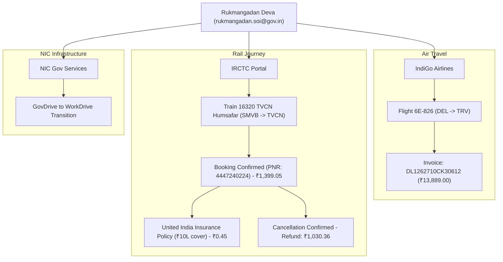

# Comprehensive Email Analysis Report

This document presents a granular analysis of all email messages located within the [`source/`](file:///home/zenhome/Projects/email-analysis/source) directory (originating from `email458144603.zip`).

---

## 1. Executive Summary

| Attribute | Details |
| :--- | :--- |
| **Recipient** | Rukmangadan Deva (`rukmangadan.soi@gov.in`) |
| **Phone Number** | +91 9940364026 |
| **Total Emails Analyzed** | 5 |
| **Date Range Covered** | 29-Oct-2026 to 31-Oct-2026 (Events reference travel dating back to 25-Oct-2026) |
| **Primary Categories** | Rail Travel Booking & Cancellation, Flight Invoicing, Travel Insurance, NIC Service Advisory |
| **Total Direct Spend** | ₹15,288.05 (IndiGo: ₹13,889.00 + IRCTC: ₹1,399.05) |
| **Total Refund Received** | ₹1,030.36 (IRCTC Train Ticket Cancellation) |
| **Net Travel Expenditure** | ₹14,257.69 |

---

## 2. Chronological Log of Communications

```
2026-10-25 (Referenced in Invoice)
 └── IndiGo Flight Booking (DEL -> TRV, PNR: NBSZJZ)

2026-10-29 22:56:23 +0530
 └── IRCTC: Ticket Booking Confirmation (SMVB -> TVCN, PNR: 4447240224)

2026-10-29 23:00:26 +0530
 └── United India Insurance: Policy Certificate Issued (PA Certificate for PNR 4447240224)

2026-10-29 23:43:11 +0530
 └── IndiGo: GST Tax Invoice DL1262710CK30612 Issued

2026-10-30 19:42:41 +0530
 └── NIC: Advisory on GovDrive Migration to WorkDrive

2026-10-31 09:24:00 +0530
 └── IRCTC: Cancellation Notice for PNR 4447240224 (Refund: ₹1030.36)
```

---

## 3. Detailed Email Breakdowns

---

### Email 1: IRCTC Train Booking Confirmation

- **File Path**: [`source/1795020946849032300/Booking Confirmation on IRCTC, Train: 16320, 01-Nov-2026, 3A, SMVB - TVCN.eml`](file:///home/zenhome/Projects/email-analysis/source/1795020946849032300/Booking%20Confirmation%20on%20IRCTC,%20Train:%2016320,%2001-Nov-2026,%203A,%20SMVB%20-%20TVCN.eml)
- **Subject**: `Booking Confirmation on IRCTC, Train: 16320, 01-Nov-2026, 3A, SMVB - TVCN`
- **Sender**: `ticketadmin@irctc.co.in`
- **Recipient**: `rukmangadan.soi@gov.in`
- **Date & Time**: `Thu, 29 Oct 2026 22:56:23 +0530`
- **Message ID**: `<1622732131.13554026.1793294783310@ngetndgbmml02.nget>`
- **Content Type**: `text/html`
- **Attachments**: None

#### Key Information Extracted:
- **Passenger**: Rukmangadan Deva (Age: 35, Male)
- **IRCTC Username**: `rukmansoi`
- **Passenger Mobile**: `9940364026`
- **PNR Number**: `4447240224`
- **Transaction ID**: `100006946133380`
- **Train Number & Name**: `16320 / TVCN HUMSAFAR`
- **Travel Class & Quota**: Third AC (3A) | General Quota
- **Journey**:
  - Origin / Boarding Station: SMVT Bengaluru (`SMVB`) — Departure: `01-Nov-2026 19:00`
  - Destination Station: Trivandrum North (`TVCN`) — Scheduled Arrival: `02-Nov-2026 10:00`
  - Distance: 842 KM
- **Seat Allocation**: Coach `B13`, Berth `22` (Status: `CNF` / Confirmed)
- **Financial Breakdown**:
  - Ticket Fare: ₹1,375.00
  - Convenience Fee: ₹23.60
  - Travel Insurance Premium: ₹0.45
  - **Total Fare Paid**: **₹1,399.05**

---

### Email 2: United India Personal Accident Insurance Certificate

- **File Path**: [`source/1795020946849032300/Congratulations your PA Insurance is issued for PNR No.4447240224 dtd 29102026`](file:///home/zenhome/Projects/email-analysis/source/1795020946849032300/Congratulations%20your%20PA%20Insurance%20is%20issued%20for%20PNR%20No.4447240224%20dtd%2029102026)
- **Subject**: `Congratulations your PA Insurance is issued for PNR No.4447240224 dtd 29/10/2026`
- **Sender**: `policy.noreply@service.uiic.co.in`
- **Recipient**: `rukmangadan.soi@gov.in`
- **Received Date**: `Thu, 29 Oct 2026 23:00:26 +0530`
- **Message ID**: `<2018991890.1531793295026393.JavaMail.DRSRPORSMSEPG$@DRSRPORSMSEPG>`
- **Content Type**: `multipart/mixed`
- **Attachments**: `PA_CERTIFICATE_4447240224.pdf` (318 KB)

#### Key Information Extracted:
- **Insured Person**: Rukmangadan Deva
- **Associated PNR**: `4447240224`
- **Certificate Number**: `44472402240129102026`
- **Master Policy Number**: `5002004224P101121449000`
- **Insurer**: United India Insurance Company Limited (Large Corporate Cell, Chennai, TN)
- **Group Policyholder**: Indian Railway Catering and Tourism Corporation Ltd. (IRCTC)
- **Cover Validity**: From entraining at SMVB (01-Nov-2026 19:00) until detraining at TVCN (02-Nov-2026 10:00).
- **Insurance Premium**:
  - Base Premium: ₹0.38
  - IGST: ₹0.07
  - **Total**: **₹0.45**
- **Coverage Schedule**:
  1. Accidental Death: ₹10,00,000/-
  2. Permanent Total Disability (PTD): ₹10,00,000/-
  3. Permanent Partial Disability (PPD): Up to ₹7,50,000/-
  4. Hospitalization Expenses for Injury: Max up to ₹2,00,000/-
  5. Transportation of Mortal Remains: Max up to ₹10,000/-

---

### Email 3: IndiGo Airlines GST Tax Invoice

- **File Path**: [`source/1795020946849032300/TaxInvoice - DL1262710CK30612.eml`](file:///home/zenhome/Projects/email-analysis/source/1795020946849032300/TaxInvoice%20-%20DL1262710CK30612.eml)
- **Subject**: `TaxInvoice - DL1262710CK30612`
- **Sender**: `6EGSTInvoice@goindigo.in`
- **Recipient**: `rukmangadan.soi@gov.in`
- **Date & Time**: `Thu, 29 Oct 2026 23:43:11 +0530`
- **Message ID**: `<a7daed$81lfpk@ob1.hc258-42.ap.iphmx.com>`
- **Content Type**: `multipart/mixed`
- **Attachments**: `TaxInvoiceDL1262710CK30612.pdf` (11.5 KB)

#### Key Information Extracted:
- **Airline**: InterGlobe Aviation Limited (IndiGo)
- **GSTIN**: `07AABCI2726B1Z4`
- **Invoice Number**: `DL1262710CK30612`
- **Invoice Date**: `25-Oct-2026`
- **Passenger**: Rukmangadan D
- **PNR**: `NBSZJZ`
- **Flight Number**: `6E - 826`
- **Sector**: Delhi (`DEL`) to Trivandrum (`TRV`)
- **Place of Supply**: Delhi
- **Pricing & Tax Schedule**:
  - Air Travel and Related Charges (SAC `996425`):
    - Taxable Value: ₹12,420.00
    - CGST (2.50%): ₹310.50
    - SGST/UGST (2.50%): ₹310.50
    - Subtotal: ₹13,041.00
  - Airport Charges (Non-taxable / Exempted): ₹848.00
  - **Grand Total Paid**: **₹13,889.00**

---

### Email 4: NIC GovDrive Decommissioning & WorkDrive Migration Notice

- **File Path**: [`source/1795020946849032300/Important Message : GovDrive Migration to WorkDrive of NIC Email Service.eml`](file:///home/zenhome/Projects/email-analysis/source/1795020946849032300/Important%20Message%20:%20GovDrive%20Migration%20to%20WorkDrive%20of%20NIC%20Email%20Service.eml)
- **Subject**: `Important Message : GovDrive Migration to WorkDrive of NIC Email Service`
- **Sender**: `no-reply@nic.in`
- **Recipient**: `rukmangadan.soi@gov.in`
- **Received Date**: `Fri, 30 Oct 2026 19:42:41 +0530`
- **Message ID**: `<710220387.6363.1793369561041.JavaMail.root@mailerjar-6c495f6d66-6vqtq>`
- **Content Type**: `multipart/mixed`
- **Attachments**: None

#### Key Information Extracted:
- **Authority**: National Informatics Centre (NIC) / Team GovDrive
- **Action Required**: Transition from GovDrive cloud storage to WorkDrive for all government email users (`mail.gov.in` and `mail.nic.in`).
- **Critical Milestone Deadlines**:
  - `31st October 2026`: GovDrive file uploads permanently discontinued.
  - `1st November 2026`: Automated migration of all existing user files to WorkDrive commences.
  - `15th December 2026`: Last date for users to manually download files from GovDrive.
  - `31st December 2026`: Full decommissioning of GovDrive portal.
- **Support Contacts**:
  - `mail.gov.in` Helpdesk: `helpdesk-email@gov.in` | Toll-Free: 18005719646 (24x7)
  - `mail.nic.in` Helpdesk: `helpdesk-email@nic.in` | Toll-Free: 18003099649 (24x7)
  - GovDrive Support: `support-govdrive@gov.in`

---

### Email 5: IRCTC Ticket Cancellation Confirmation

- **File Path**: [`source/1795020946849032300/Cancel Ticket.eml`](file:///home/zenhome/Projects/email-analysis/source/1795020946849032300/Cancel%20Ticket.eml)
- **Subject**: `Cancel Ticket`
- **Sender**: `ticketadmin@irctc.co.in`
- **Recipient**: `rukmangadan.soi@gov.in`
- **Date & Time**: `Sat, 31 Oct 2026 09:24:00 +0530`
- **Message ID**: `<1946693535.13824083.1793418840888@ngetndgbmml01.nget>`
- **Content Type**: `text/html`
- **Attachments**: None

#### Key Information Extracted:
- **Action**: Confirmed cancellation of rail reservation.
- **PNR Number**: `4447240224`
- **Refund Amount**: **₹1,030.36**
- **Original Fare Paid**: ₹1,399.05 (Base fare: ₹1375.00, Convenience: ₹23.60, Insurance: ₹0.45)
- **Cancellation Charge Deducted**: ₹368.69 (includes IRCTC flat cancellation fee for 3A and non-refundable fees)

---

## 4. Entity Cross-Reference & Correlation


